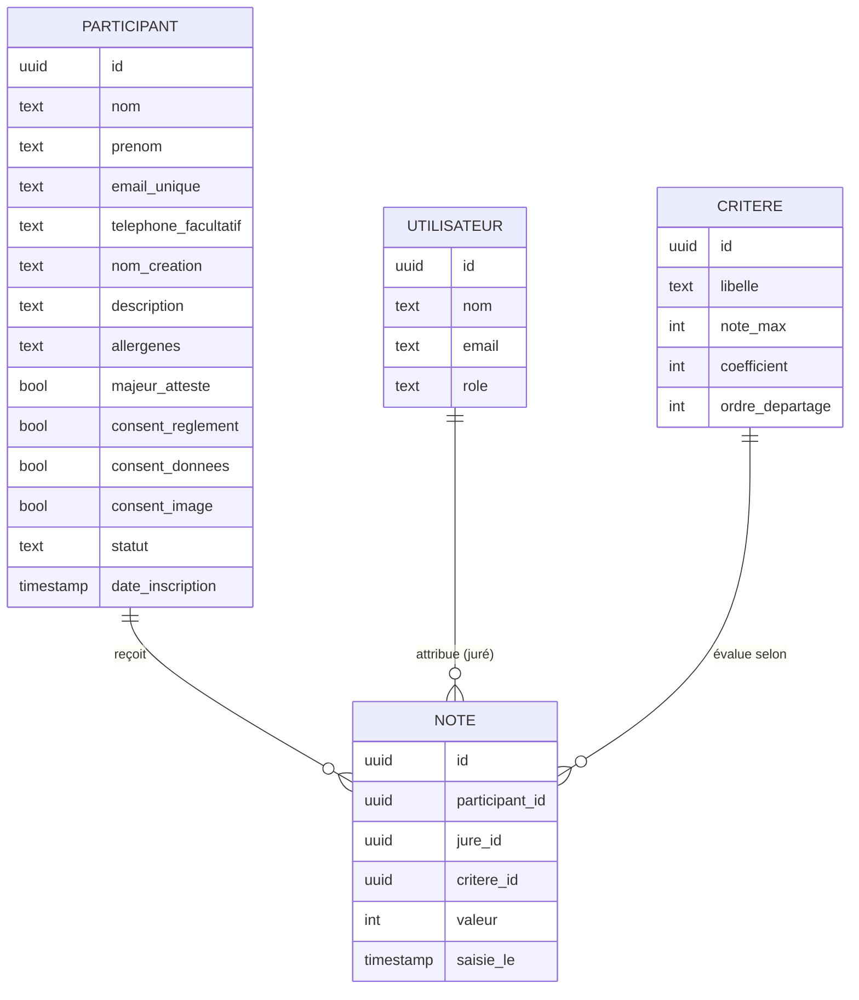

# Note de cadrage — Le Four du Canal (CADRE-FOURDUCANAL-2026)

<aside>
⚠️

**Cas fictif : aucune réponse client n'a été obtenue.** Toutes les informations marquées **[H]** sont des hypothèses de travail, retenues pour pouvoir construire. Elles sont listées dans la section « Questions posées et hypothèses » et seraient à faire valider par le client avant une mise en production réelle.

</aside>

**Référence** : CADRE-FOURDUCANAL-2026 · **Niveau choisi** : Niveau 2 (landing page + petite application). Les e-mails sont conçus (contenu, déclencheur, destinataire) mais pas envoyés : voir « Périmètre ».

## ❓ Contexte

Le Four du Canal est une pâtisserie indépendante disposant d'un site WordPress. Elle organise un **concours amateur de pâtisserie dans trois semaines**. Le délai court est le déclencheur du projet : il faut pouvoir communiquer et recueillir les inscriptions rapidement, puis gérer le jour J (participants, notes du jury, classement) sans tableur bricolé.

## 🪫 Le besoin / les enjeux

- Présenter le concours de façon claire et donner envie de participer.
- Recueillir des inscriptions fiables (données complètes, pas de doublons, jauge respectée).
- Suivre les participants et saisir les notes du jury le jour J.
- Produire un classement juste, conforme à des règles connues à l'avance.
- Informer les participants par e-mail (confirmation, rappel).

## 🔋 Compréhension du besoin

La cliente veut une page dédiée au concours, reliée à son site actuel, avec un formulaire d'inscription simple. Côté organisation, elle a besoin d'un outil réservé à l'équipe pour consulter les inscrits, faire saisir les notes par les jurés selon des critères définis, et obtenir un classement calculé automatiquement. Les e-mails liés à l'événement sont souhaités mais secondaires par rapport à l'inscription et au classement.

### Questions posées et hypothèses retenues

| Question au client | Réponse client | Hypothèse retenue [H] |
| --- | --- | --- |
| Date, horaires, lieu ? | Non obtenue (cas fictif) | Samedi 5 décembre 2026, 14 h–18 h, à la pâtisserie (adresse à préciser) |
| Jauge maximale ? | Non obtenue | 20 participants |
| Qui peut participer ? | Non obtenue | Amateurs majeurs (18 ans et plus), professionnels exclus ; attestation sur l'honneur, pas de date de naissance demandée |
| Inscription payante ? | Non obtenue | Gratuite (aucun paiement en ligne) |
| Format de l'épreuve ? | Non obtenue | Thème unique « Pâtisserie d'hiver » ; création réalisée à domicile et apportée le jour J ; une seule catégorie |
| Composition du jury ? | Non obtenue | 3 jurés |
| Critères et pondération ? | Non obtenue | Goût /10 (coef. 2), Aspect visuel /10 (coef. 1), Créativité et respect du thème /10 (coef. 1) |
| Calcul du classement ? | Non obtenue | Note de chaque juré = somme pondérée ramenée sur 20 ; note finale = moyenne des jurés ; classement décroissant |
| Égalité ? | Non obtenue | Départage par la note moyenne de Goût, puis décision du jury |
| Classement public ? | Non obtenue | Interne jusqu'à la proclamation ; pas d'affichage public en V1 |
| Lots ? | Non obtenue | À préciser — non affichés sur la page |
| Accès à l'administration WordPress ? | Non obtenue | Non garanti → page séparée, reliée depuis le site |
| Outil d'e-mailing existant ? | Non obtenue | Aucun → e-mails conçus mais non envoyés en V1 |
| Photos le jour J ? | Non obtenue | Possibles → consentement droit à l'image facultatif et séparé |

### Nombre prévisionnel d'utilisateurs

- **Public** : visiteurs de la page, volume inconnu (à valider).
- **Participants** : 20 au maximum [H].
- **Équipe** : 1 gérante + 1 à 2 personnes de l'équipe + 3 jurés [H], soit 4 à 6 utilisateurs de l'outil, dont 3 simultanés le jour J (saisie des notes).
- **Usage** : page publique majoritairement consultée sur mobile ; saisie des notes sur tablette ou téléphone.

### Profils utilisateurs

| Profil | Personne(s) | Rôle |
| --- | --- | --- |
| Gérante (administratrice) | Gérante de la pâtisserie (nom à préciser) | Pilote le concours, gère les inscrits, valide le classement |
| Équipe organisatrice | 1 à 2 personnes [H] | Accueil, pointage des présents, mise à jour des fiches |
| Juré | 3 personnes [H] | Saisit ses propres notes |
| Participant | Public inscrit | S'inscrit via la page, reçoit les informations |

### Droits d'accès

L = Lecture · C = Création · M = Modification · S = Suppression · — = aucun accès

| Données / actions | Gérante | Équipe | Juré | Participant / public |
| --- | --- | --- | --- | --- |
| Informations du concours (page publique) | L.M | L | L | L |
| Inscription | L.C.M.S | L.M | — | C (sa propre inscription) |
| Coordonnées des participants (e-mail, téléphone) | L.M.S | L | — | — |
| Nom de la création, description, allergènes | L.M | L | L | — |
| Notes du jury | L.M.S | — | L.C.M (ses seules notes) | — |
| Classement | L | — | — | — (V1) |
| Critères et pondérations | L.M | L | L | — |

<aside>
🔒

**Limites de sécurité du prototype** : accès à l'outil par connexion e-mail + mot de passe, avec rôles ; pas de double authentification ; pas d'audit de sécurité ; les jurés ne voient ni les coordonnées des participants ni les notes des autres jurés. Prototype de démonstration, non prévu pour un usage réel en l'état.

</aside>

### Contraintes opérationnelles identifiées

- **Délai** : événement dans trois semaines ; rendu du prototype lundi.
- **Site existant** : WordPress, niveau d'accès inconnu.
- **Mobile** : inscription et saisie des notes sur smartphone ou tablette.
- **Jour J** : saisie rapide, sans formation préalable des jurés.

### Gestion des données

**Données sensibles « métier »** : notes du jury et classement avant proclamation (confidentialité, équité).

**Données personnelles (RGPD)** :

- Minimisation : nom, prénom, e-mail, téléphone (facultatif), attestation de majorité ; pas de date de naissance ni d'adresse postale.
- Mention d'information sous le formulaire : responsable du traitement, finalité (organisation du concours), durée de conservation, droits d'accès, de rectification et d'effacement, contact.
- Consentements par cases à cocher non pré-cochées : règlement (obligatoire), traitement des données (obligatoire), droit à l'image (facultatif, séparé).
- Durée de conservation [H] : suppression trois mois après le concours.
- Les allergènes déclarés concernent la création, pas la santé du participant.

## 🗺️ Le périmètre

<aside>
🗺️

**Niveau 1 — Landing page** : présentation du concours, formulaire d'inscription avec validation des champs, messages d'erreur utiles, message de confirmation, contrôle des doublons d'e-mail et de la jauge, page responsive, articulation avec WordPress (page séparée + lien).

**Niveau 2 — Outil d'organisation** : connexion par rôle, liste des participants (consultation, statut, pointage des présents), saisie des notes par juré et par critère, calcul et affichage du classement selon les règles retenues.

**E-mails (conception seulement)** : contenu, déclencheur et destinataire rédigés pour la confirmation et le rappel. **Aucun envoi réel** : le prototype ne prétend pas envoyer d'e-mail.

</aside>

### E-mails prévus (conçus, non envoyés)

| E-mail | Déclencheur | Destinataire | Contenu |
| --- | --- | --- | --- |
| Confirmation d'inscription | Inscription enregistrée | Le participant | Récapitulatif, date, lieu, règlement, contact, lien de désinscription |
| Rappel | 48 h avant l'événement | Inscrits confirmés | Date, heure d'arrivée, adresse, consignes (création à apporter, fiche allergènes) |

### Articulation avec WordPress

La page du concours est hébergée **séparément** (URL de démonstration, idéalement un sous-domaine du type concours.[domaine] à terme). Le site WordPress y renvoie par un lien dans le menu et un bandeau en page d'accueil. Raisons : aucun accès à l'administration garanti, aucun risque pour le site en place, mise en ligne rapide. Option si l'accès est confirmé : intégration via un bloc HTML ou une iframe.

## ❌ Exclusions

<aside>
❌

- Envoi réel d'e-mails.
- Paiement en ligne.
- Modification du thème ou des extensions WordPress.
- Affichage public du classement en direct.
- Gestion de plusieurs catégories ou de plusieurs concours.
- Mise en production réelle avec données de vrais participants.
</aside>

## 🚀 Perspectives d'évolution (V2)

- **E-mails automatiques** : brancher un service d'envoi (Brevo, par exemple) pour envoyer automatiquement la confirmation et le rappel, ce qui éviterait les relances manuelles la veille.
- **Écran de proclamation** : afficher le podium sur grand écran au moment de l'annonce des résultats.
- **E-mail des résultats et remerciements**, avec la galerie photos (participants ayant consenti au droit à l'image).
- **Liste d'attente** automatique lorsque la jauge est atteinte.
- **Réutilisation** : rendre l'outil paramétrable pour les éditions suivantes ou d'autres animations de la boutique.

## ⚙️ Fonctions principales de la solution

| Fonction | Description |
| --- | --- |
| Présenter le concours | Page avec date, lieu, thème, déroulé, règles et critères de notation |
| S'inscrire | Formulaire validé, consentements, message de succès ou d'erreur |
| Contrôler les inscriptions | Refus des doublons d'e-mail, message « complet » au-delà de 20 |
| Se connecter à l'outil | Accès selon le rôle (gérante, équipe, juré) |
| Gérer les participants | Liste, recherche, statut (inscrit / présent / désisté) |
| Noter | Formulaire par participant et par critère, notes de 0 à 10 |
| Classer | Calcul pondéré, moyenne des jurés, départage, affichage du classement |

## 🧰 La stack (proposée, à confirmer au démarrage du développement)

- **Développement assisté par IA** : Claude Code.
- **Interface** : page web responsive (HTML / CSS / JavaScript).
- **Données et connexion** : base de données hébergée avec authentification par rôles (par exemple Supabase, offre gratuite).
- **Code** : dépôt GitHub. **Démo** : hébergement gratuit (Netlify ou Vercel).

## ❗ Les pré-requis

**Comptes à créer** : GitHub, service de base de données, hébergeur. **Informations client** : aucune n'est bloquante pour le prototype (les hypothèses en tiennent lieu) ; toutes seraient bloquantes avant une mise en production réelle.

## 🔀 Organisation

- **Parties prenantes** : la gérante (cliente, fictive) ; Véronique Chapelle (conception et réalisation).
- **Budget** : sans objet (exercice de formation).

| Jalon | Date prévisionnelle | Commentaire |
| --- | --- | --- |
| Cadrage et hypothèses | Samedi 14 novembre | Présente note |
| Landing page + inscription | Dimanche 15 novembre (matin) | Niveau 1 complet avant de passer au niveau 2 |
| Outil d'organisation | Dimanche 15 novembre (après-midi) | Participants, notes, classement |
| Vérifications + README | Dimanche 15 novembre (soir) | Résultats consignés ci-dessous |
| Démonstration + rendu | Lundi 16 novembre | Enregistrement du parcours principal |

## ✅ Vérifications prévues

| # | Vérification | Résultat attendu | Résultat obtenu |
| --- | --- | --- | --- |
| 1 | Inscription valide | Message de succès ; le participant apparaît dans la liste de l'outil | À compléter |
| 2 | Cas d'erreur : champ obligatoire vide, e-mail invalide, e-mail déjà inscrit, jauge atteinte | Message d'erreur précis, aucune inscription créée | À compléter |
| 3 | Classement : 3 participants notés par 3 jurés, comparés à un calcul manuel | Notes finales et ordre identiques au calcul manuel | À compléter |
| 4 | Affichage mobile (largeur 375 px) | Page lisible, formulaire utilisable sans zoom | À compléter |
| 5 | Accès à l'outil sans connexion, puis en tant que juré | Accès refusé ; le juré ne voit pas les coordonnées | À compléter |

## 🧩 Modèle de données (ERD)

<aside>
🧠

**Justification des choix**

- **NOTE est une table à part**, avec une ligne par participant × juré × critère (combinaison unique). Cela permet à chaque juré de ne modifier que ses propres notes et de recalculer le classement à tout moment ; le classement est calculé, jamais stocké.
- **CRITERE est une table** plutôt que trois colonnes figées : la cliente peut changer critères et coefficients sans toucher au code, ce qui est utile tant que les règles ne sont pas confirmées.
- **Une table UTILISATEUR unique avec un rôle** (gérante, équipe, juré) : un seul système de connexion et des droits appliqués selon le rôle, conformément à la matrice des droits d'accès.
- **Les coordonnées restent dans PARTICIPANT et ne sont jamais exposées au rôle juré**, qui ne lit que le nom de la création, la description et les allergènes.
- **Entités écartées** : ~~CONCOURS~~ (un seul événement : paramètres fixes en V1, table à créer en V2 si l'outil est réutilisé) ; ~~CATEGORIE~~ (une seule catégorie retenue) ; ~~EMAIL_ENVOYÉ~~ (pas d'envoi en V1 ; à ajouter avec les e-mails automatiques en V2).
</aside>

## 📞 Suite et support

Prototype livré avec un README (lancement et liste de ce qui fonctionne réellement). Prochaine étape utile : valider les hypothèses [H] avec la cliente, puis brancher l'envoi d'e-mails (V2).